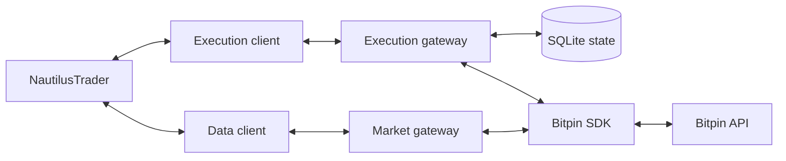

# Crypto Max

**An evidence-driven Bitpin spot-market adapter for NautilusTrader.**

`Python 3.14+` · `NautilusTrader` · `REST` · `WebSocket` · `SQLite`

Crypto Max explores the infrastructure for a single-user algorithmic trading platform, focusing on accurate exchange integration, typed market data, deterministic verification and recoverable local state.

## Integration architecture

| Component | Responsibility |
| --- | --- |
| Instrument provider | Currency and spot-instrument registration |
| Market-data gateway | Async SDK boundary, REST and public WebSocket streams |
| Data client | Typed history, quotes, trades, candles and order books |
| Execution client | Order, fill and balance mapping and reconciliation |
| Execution gateway | Explicit write-enable and suspension gating |
| State store | SQLite order identities, fill IDs and reconciliation checkpoints |
| Probe and tests | Evidence capture and fixture-based verification |



## Design

- Separate exchange protocol mapping from market-selection policy.
- Preserve native IRT units, instrument identities and decimal precision.
- Reconcile execution outcomes and duplicate events through persistent state.
- Keep unsupported exchange capabilities explicit.

## Local development

Install Python 3.14+ and [uv](https://docs.astral.sh/uv/).

```bash
git clone https://github.com/I-Do-CS/crypto-max.git
cd crypto-max
uv sync --locked
uv run pytest
```

Start with fixture-backed tests. Live execution remains under validation; this is a development project, not a production trading system.

## Documentation

- [Integration contract](docs/bitpin-integration-contract.md)
- [Smoke test](docs/post-maintenance-smoke-test.md)
- [Wallet endpoint changes](docs/bitpin-wallet-deprecations.md)
- [Integration modules](src/crypto_max/)
- [Test suite](tests/)

Independent, AI-assisted project by [Ali Ghelichkhani](https://github.com/I-Do-CS).
